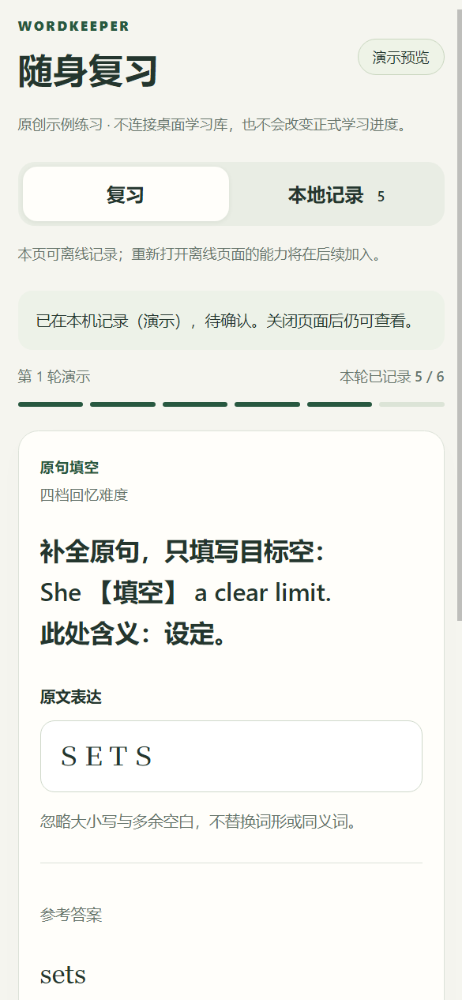

# 移动复习演示原型（P4 A1）

2026-10-30，基线 d61f25e。独立 Web 入口已实现六类卡、真实 IndexedDB 本地记录及待确认/冲突示例。**目前使用原创演示包，未连接桌面学习库，不会改变正式学习进度。** 设备配对、签名复习包与正式同步继续在 A2 开发。

## 本地打开与构建

在源码目录安装依赖后运行：

```powershell
npm run dev:mobile
```

使用本机浏览器打开 [本地移动预览](http://127.0.0.1:5174/)。开发服务只绑定本机，不是可供手机直接访问的公网入口。也可以构建独立静态产物：

```powershell
npm run build:mobile
```

输出在 `dist-mobile/`，不覆盖桌面的 `dist/`，不进入现有安装包。构建产物需要静态 HTTP/HTTPS 服务，不能依赖双击本地 HTML。正式 HTTPS 部署、PWA 离线页面壳及 Android/iOS 实机验收仍在 A3，当前没有发布站点或提供正式手机安装入口。

## 可以体验的流程

点击“开始六题演示”，依次练习问答、翻译、判断、选择、拼写与原句填空。题面先显示作答区域，翻面后展示参考答案、解释和出处。输入题的答案、解析和来源标题在翻面前不显示；空回车不会揭示，明确“没想起”可以查看答案。

问答和翻译由用户对照后自评，不自动判分。客观题先选合法答案，拼写按桌面 `typed-answer:v1` 忽略兼容字符、大小写、撇号和多余空白，不猜同义词或词形。错误拼写只能选“不会”，FSRS 四档的错误作答只能选“没想起”；旧判断题仍保留原三档错误可选“模糊”的行为。

评分后，等 IndexedDB 事务完成才显示本地记录成功，并进入下一张。保存失败保留输入和本次操作身份，可点击“重试本次记录”；也可保留输入重新作答。相同操作重试不会重复存记录或消耗序号；同卡已有待确认记录时不能在另一页面再次覆盖。

“本地记录”可按全部、待确认、确认示例、冲突示例筛选。每条保留原题、原始回答、评分、时间与原始出处。模拟按钮只演示回执状态，不代表实际桌面确认；版本冲突示例保留原作答，不覆盖新题。



## 本地数据与操作边界

- 使用独立数据库 `cet-wordkeeper-mobile-demo-v1`，只读写当前浏览器的演示数据。没有 preload、Electron IPC、正式用户数据库或 AI 配置依赖。
- 已评分的作答与题目快照同事务保存，关闭并重新打开后仍能恢复。未评分输入只保存在当前页面；应用内主动切换/结束有放弃确认，浏览器原生离页提示取决于平台支持，不承诺未评分草稿可在重启后恢复。
- 已打开页面在断网下可以记录和查看。离线重新加载/首次打开页面尚无保证，当前没有 Service Worker。浏览器删除站点数据、无痕模式退出或设备故障不在普通重启恢复保证之内。
- 使用库/设备/批次身份、卡片版本与内容摘要、固定操作身份和事务内递增序号。演示批次有效 24 小时，过期拒绝新增，但已保存操作仍可原身份重试。尚有待确认项时不自动开始新轮次。
- 每条记录保留原始大小写和空白；移动端不计算正式 due、FSRS 记忆状态、额度或学习完成统计。示例中的三档/四档用于验证交互与传输语义。
- 本地最多 200 条。新轮次保留旧历史；“清理确认示例”只删除已模拟确认项，保留待确认与冲突。清空全部演示数据需要另一次明确确认，不自动删除冲突腾位置。
- “导出演示副本”下载 `cet-wordkeeper-mobile-demo-archive` JSON，包含已保存状态与原始记录；它不是签名作答包、数据库备份或可导入桌面的正式学习记录。当前未提供任何外部复习包/回执导入入口。

## 存储实现

`mobile/lib/store.mjs` 提供演示作用域的实际 IndexedDB 适配器，复用 `shared/mobile-review-contract.mjs`。同一读写事务中读取最新状态、分配序号、写作答与快照，等 complete 才报告成功。事务中止/异常不返回成功，也不修改旧状态。不在事务中等待网络或异步摘要计算。

原始回答、卡片快照和确认状态始终一并保存；确认不可无提示改成另一类型。字段、身份、快照与队列关系在读取和写入时重新校验，未知/损坏格式会报错并保留原数据，不自动重置或用旧格式覆盖。版本升级阻塞、空间不足和不可用存储有明确提示。`durability: strict` 不受支持时回退普通事务，仍等待事务完成；不把正常关闭重启验证描述为断电情况下绝不丢失。

BroadcastChannel 仅通知其他页面数据已更新，不自动覆盖正在输入的草稿。保存时仍从数据库重读，防止同卡重复或旧轮次写入；重新读取需确认放弃未保存内容。回执模拟属于显式演示功能，不是产品测试开关或认证能力。

`mobile/lib/review-model.mjs` 保留版本化输入核对，专项与桌面比较完整结果，避免两种模块环境中的规则静默分叉。未来真实入账必须由桌面再次校验实际答案。完整配对、签名与联合事务约束见 [MOBILE-REVIEW-DESIGN.md](MOBILE-REVIEW-DESIGN.md)。

## 验证与交付

运行 `npm run test:mobile-review`，包含独立移动构建、12 项模型/桌面一致性和 39 项真实移动页面/存储检查。覆盖六类题、先作答、错误评分、原始输入、事务中止与原样重试、实际下载、状态筛选、明确清理、跨页通知、并发写序号、过期与新轮次、断网记录、重启恢复、事务提示兼容以及损坏状态拒绝覆盖。320/390/768 像素布局无横向溢出，已审阅实际渲染截图。

原协议专项另外 28 项数据演练与 13 项 Chromium/IndexedDB 技术验证通过，本批共 **92 项相关检查**；桌面与移动构建均通过。测试仅使用专用临时目录、隐藏浏览器和绑定 127.0.0.1 的本地服务，保存结束后关闭清理，无模型、真实用户库或正式同步请求。未运行无关全量 CI，未做 Android/iOS 实机或公网部署验证。

本批仍为源码交付，没有重建分发库、覆盖安装目录、制作新安装包或改变 v0.3.3 标签/附件。下一批 A2 先接设备身份与签名文件，再重构评分内部事务，使正式评分和移动回执同时提交。
